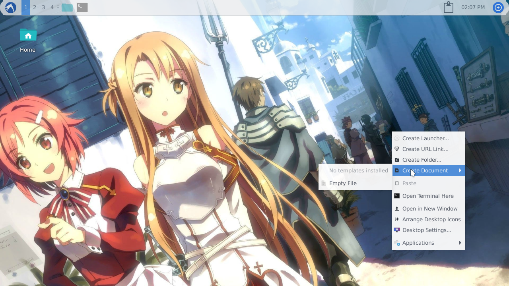
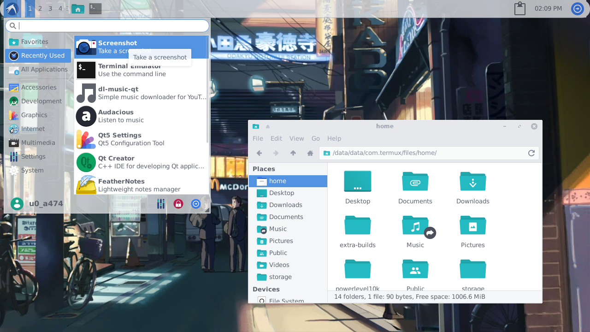
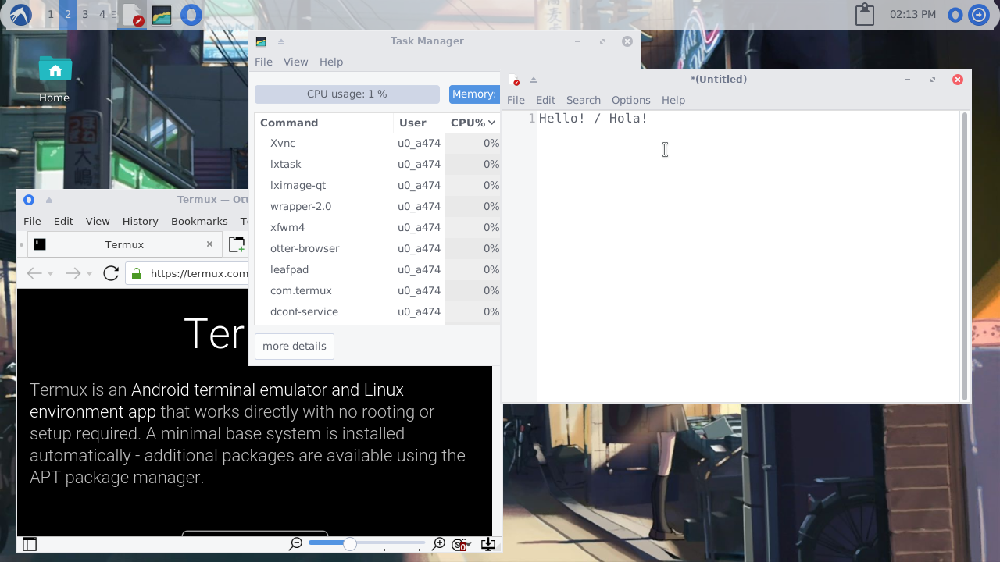
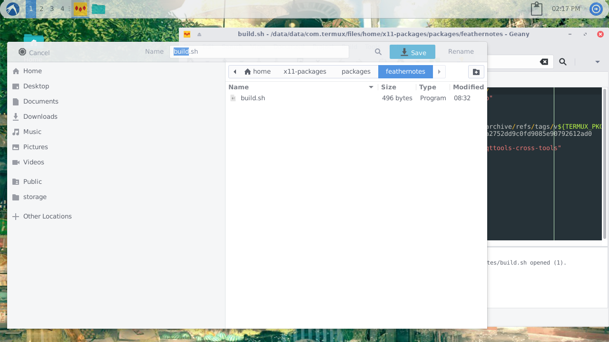
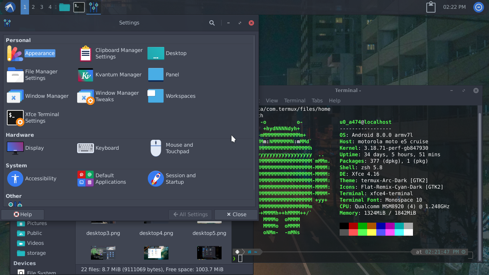

# termux-desktop-xfce

# ¡Atención! / ¡Warning!

This project will no longer be maintained, I currently have many occupations because I am going to enter the Air Force 🙏🏻.

You can try additional projects like this:

https://github.com/sabamdarif/termux-desktop

It's a pretty cool project and pretty much accomplished everything I wanted to accomplish with this project.

Possibly in the future I will contribute with things to that repository in my free space.

## Tareas
 - Rediseño en temas de la interfaz.
 - Buscar una alternativa más ligera a Papirus icons que siga el esquema de Material Desing
 - agregar una bonita pantalla de bienvenida que ayudará al usuario a dar sus primeros pasos (configuración y agregar software adicional), también puede elegir qué navegador desea usar por defecto (Esto le dará una experiencia más amigable, similar a una distribución GNU/Linux)
 - intentar empaquetar todas las modificaciones en paquetes, no modifique $HOME para comodidad del usuario.
 - ¡Y muchas sorpresas más!

 Gracias por su atención, puede continuar con la descripción del proyecto.

Set up a beautiful xfce desktop in termux 

README in English:

https://github.com/Yisus7u7/termux-desktop-xfce/blob/main/README-en.md

## Requisitos 

`No Necesita permisos root`

Android 7, 8, 9, 10, 11 o 12

Termux : https://f-droid.org/en/packages/com.termux/

1 GB de ram mínimo, 2 GB recomendado 

1 GB de espacio 

Un cliente vnc con el cual conectarse, 
Puedes usar este :

https://play.google.com/store/apps/details?id=com.realvnc.viewer.android

También puedes usar xserver-xsdl, bvnc pro y 
kali-Kex

> Nota : el termux de la play store es desmantenido 
y no recibe actualizaciones, no lo uses. tiene 
bugs, usa el del enlace que deje arriba 

# Que es? 

Esto es una configuración avanzada de termux x11, 
rica en funciones para ser altamente funcional,
con un aspecto atractivo, altamente personalizable
y con una optimización muy buena, esto fue 
inspirado en :

https://manjaro.org

Y

https://github.com/adi1090x/termux-desktop

Haciendo como resultado un escritorio altamente
útil y optimizado. 

# capturas de pantalla :

> versión actual : 5.0.3 update








## Temas

Aparte de las capturas de pantalla anteriores, hay muchos
más temas que usted podrá cambiar desde ajustes, también
otros fondos de pantalla


> pocas apps?, he echo una configuración para 
> ejecutar las apps de una distro proot en termux x11! 
> Un ejemplo :

```
./start-ubuntu.sh

apt install firefox

export DISPLAY=:1

firefox 
```

### puede ejecutar apps proot sin problemas

 
 
 

# instalación 

⚠ Solo en termux 

```bash
curl -sLf https://raw.githubusercontent.com/Yisus7u7/termux-desktop-xfce/main/boostrap.sh | bash
```

> luego de eso solo espere, el script hará su trabajo 

# Uso 

usa el comando :

```
vncserver -listen tcp 
```

Pará iniciar el servidor vnc, conectese a localhost:1
O el puerto que haya indicado la terminal 

Cualquier error, pregunta o sujerencia reportala en :
https://github.com/Yisus7u7/termux-desktop-xfce/issues


`Espero que te guste este pequeño trabajo,
No olvides dejar tu 🌟 y compartir :3`

Puedes donar a este pequeño proyecto en paypal

https://paypal.me/JesusChapmanVlz

Se agradecerá 😉
